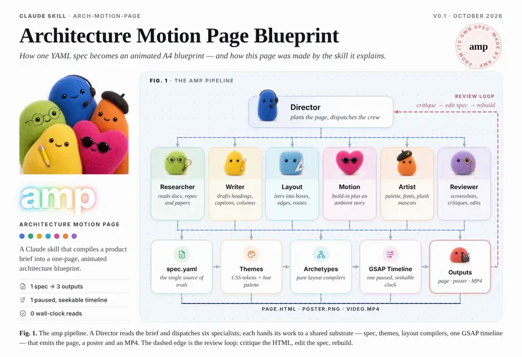
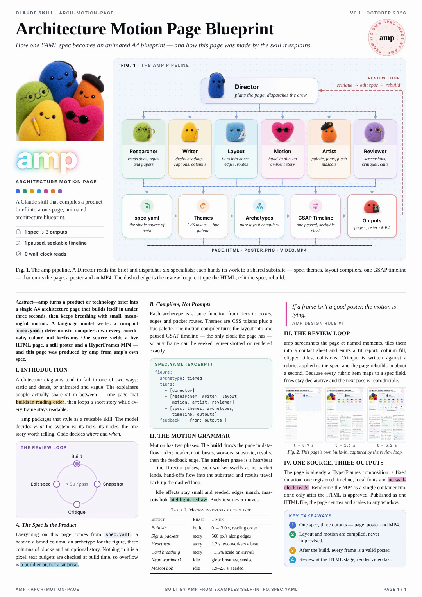
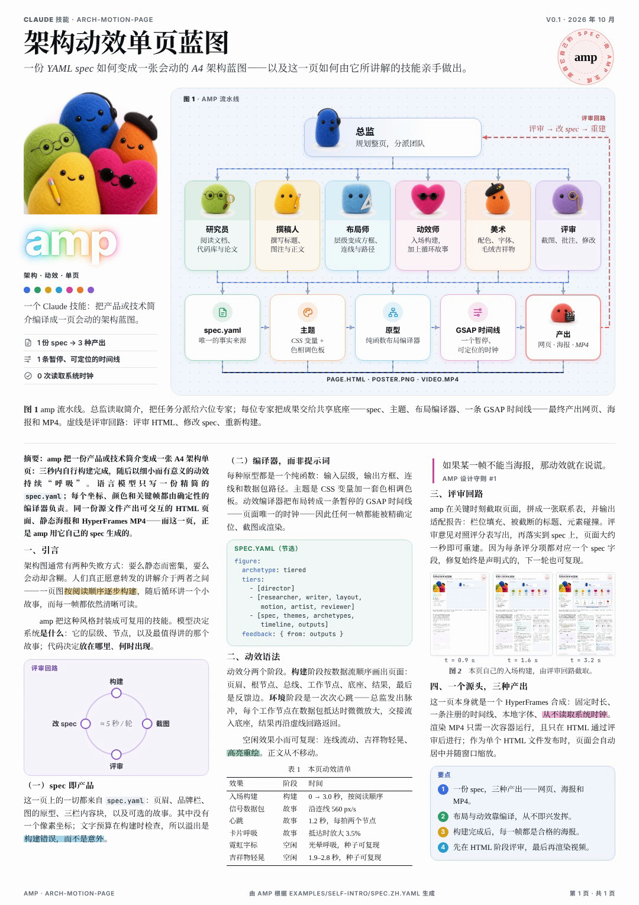
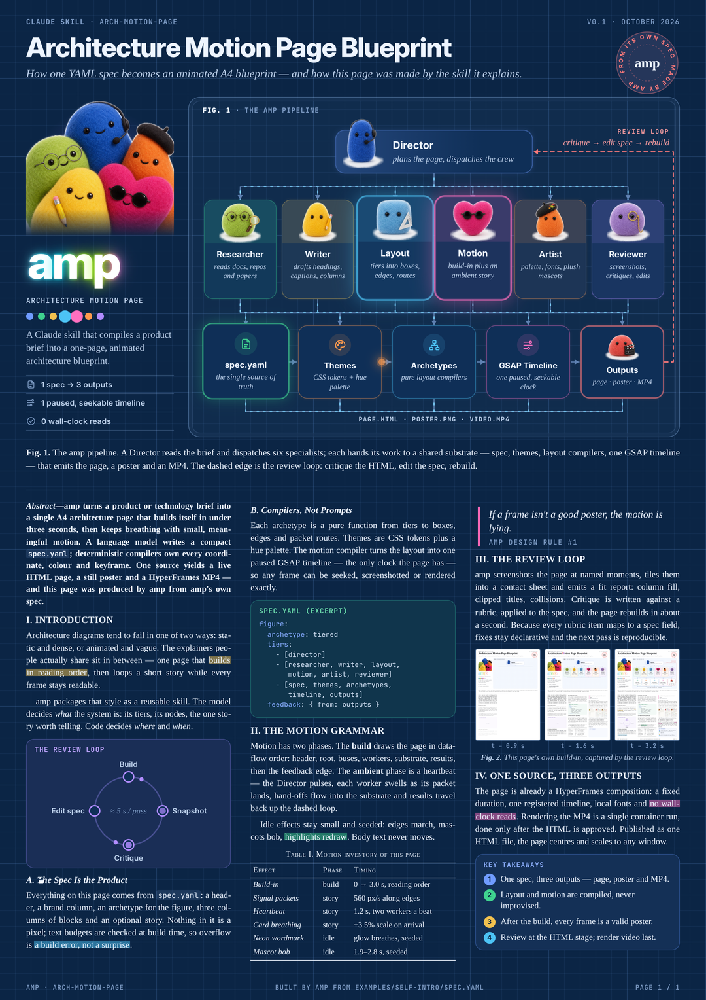

<p align="center">
  
</p>

<h1 align="center">arch-motion-page</h1>

<p align="center">
  <b>An agent skill that turns a system architecture into a one-page, animated A4 blueprint:<br>live HTML, a poster PNG and an MP4, all from one small YAML spec.</b>
</p>

<p align="center">
  <b>English</b> · <a href="README.zh-CN.md">简体中文</a>
</p>

<p align="center">
  <a href="https://joeeeeey.github.io/arch-motion-page/"></a>
  
  
  
  
  <a href="LICENSE"></a>
</p>

<p align="center">
  
</p>

<p align="center">
  <sub>The example page explains amp using amp's own pipeline. It was built and rendered by this skill.<br>
  ▶ <a href="https://github.com/joeeeeey/arch-motion-page/releases/download/v0.1.0/amp-self-intro.mp4">Full MP4 (EN, 24 s)</a> ·
  <a href="https://github.com/joeeeeey/arch-motion-page/releases/download/v0.1.0/amp-self-intro-zh.mp4">中文 MP4</a> ·
  <a href="https://joeeeeey.github.io/arch-motion-page/">Live HTML</a> ·
  <a href="https://joeeeeey.github.io/arch-motion-page/zh.html">中文 HTML</a></sub>
</p>

---

## What it does

Describe a system: an entry point, the roles or services it dispatches to, and what they share or produce. **amp** (arch-motion-page) lays it out as an academic-style A4 page with a header, a brand column, a three-tier figure and three columns of text, then animates it:

- **Builds itself in about 3 s.** Then it loops a *heartbeat story*: the root pulses, signal packets travel the edges, each worker card swells as its packet lands, and the hand-off flows into the substrate.
- **Every frame after the build is a usable poster.** Edges march, mascots bob, and a neon gradient wordmark breathes.
- **One spec, three outputs.** You get a live HTML page (present mode, keyboard controls, one-file publishing), a poster PNG and an MP4 rendered by [HyperFrames](https://www.npmjs.com/package/hyperframes).
- **The agent writes only the YAML.** Deterministic compilers own every coordinate, colour and keyframe. No wall-clock reads and no unseeded randomness, so a frame at `t = 12.5 s` is identical in the browser and in the video.
- **Reviewed before rendering.** A runtime fit report flags overflowing text and columns. A review script captures frames at named story events, and a rubric guides the edit, rebuild, review loop.
- **English or Chinese** (`meta.lang: zh`) with pinned Noto SC fonts, subset per page. Two skins: white paper (`plush-academic`, the default) and navy `blueprint`.

| White paper (default) | 中文 | Blueprint |
|:---:|:---:|:---:|
| <a href="https://joeeeeey.github.io/arch-motion-page/"></a> | <a href="https://joeeeeey.github.io/arch-motion-page/zh.html"></a> | <a href="https://joeeeeey.github.io/arch-motion-page/blueprint.html"></a> |

<sub>Click a poster to open its live page.</sub>

## Example conversations

Install the skill (below), then just ask. The skill handles analysis, spec, build, review and render.

**In English**

> **You:** Use arch-motion-page to make an animated A4 page for our checkout system. The API gateway fans out to cart, pricing, payment and fulfilment; they share Postgres and Kafka, and the outcome is a confirmed order.
>
> **Claude:** I split it into three tiers:
> - **Root:** API Gateway.
> - **Workers:** Cart · Pricing · Payment · Fulfilment.
> - **Substrate → outcome:** Postgres · Kafka → Order confirmed.
>
> I also added a dashed feedback edge for refunds back to the gateway. I wrote `/tmp/amp-checkout/spec.yaml`, built it and reviewed the frames. The fit report is OK and the columns fill 93 / 96 / 91 %. Open `out/index.html` to watch it loop. Shall I render the MP4?
>
> **You:** Make the Payment card say "3DS + retries", try the blueprint skin, then render.
>
> **Claude:** I updated the spec, rebuilt with `--theme blueprint` and re-reviewed. HyperFrames lint, check and render ran inside Docker, and the result is in `out/renders/amp-checkout.mp4` (24 s).

**In Chinese / 中文**

> **你：** 用 arch-motion-page 把我们的 RAG 问答系统做成一页会动的 A4 架构图，要中文版。
>
> **Claude：** 我按三层拆：
> - **根节点**：问答编排器。
> - **工作节点**：检索、重排、生成、引用校验。
> - **底座 → 结果**：向量库、文档仓库 → 可信回答。
>
> 另外加了一条"用户反馈 → 编排器"的虚线反馈边。spec 写在 `/tmp/amp-rag/spec.zh.yaml`（`meta.lang: zh`），已经构建并审过帧：fit report 通过，三栏填充 92 / 95 / 90 %。打开 `out-zh/index.html` 就能看到循环动画。
>
> **你：** 再给我一个能直接发给同事的单文件 HTML。
>
> **Claude：** 已经加 `--single` 重新构建，输出 `out-zh/single/amp-rag-zh.html`，脚本、字体子集和图片都内联在这一个文件里，离线也能打开。按 F 键可以整页适配窗口。

## Install

Requirements:
- **Node.js ≥ 22**
- **Google Chrome or Chromium**, for the review screenshots (set `CHROME=/path` if it is not in a standard location)
- **Docker**, for MP4 rendering and for Chinese font subsetting (Chinese pages and `--single` builds). The skill never runs HyperFrames or fonttools on the host.

```bash
# Any agent (Claude Code, Codex, Cursor, …), via the skills CLI from skills.sh
npx skills add joeeeeey/arch-motion-page            # add -g to install for every project

# Or by hand: Claude Code personal skill (available in every project)
git clone https://github.com/joeeeeey/arch-motion-page ~/.claude/skills/arch-motion-page
cd ~/.claude/skills/arch-motion-page && npm install
```

`npx skills add` asks which agents to install for and puts the skill in each one's skills folder: `.claude/skills/` for Claude Code, or `~/.claude/skills/` with `-g`. It does not run `npm install`; the skill's setup step has the agent run it on first use. To share it with a team by hand, clone it into a project's `.claude/skills/arch-motion-page` instead. Other agents that read the `SKILL.md` format can use the same folder from their own skills directory.

## Quick start (without an agent)

```bash
node scripts/build.mjs examples/self-intro/spec.yaml            # -> examples/self-intro/out/
open examples/self-intro/out/index.html                          # autoplays, centred; Space / F / ← → / Home
node scripts/review.mjs examples/self-intro/out                  # frames, contact sheet, fit report
node scripts/build.mjs examples/self-intro/spec.zh.yaml          # Chinese version -> out-zh/
node scripts/build.mjs examples/self-intro/spec.yaml --single    # one self-contained file -> out/single/
scripts/render.sh examples/self-intro/out                        # MP4 via HyperFrames, inside Docker
```

The first Chinese or `--single` build creates a small fonttools image and downloads the pinned Noto SC fonts once. The first render creates the HyperFrames image (Debian, ffmpeg and headless Chrome) once. Later runs take seconds plus the render itself.

## How it works

```
spec.yaml ─▶ lib/spec.mjs                  validate, character budgets (CJK counts double)
          ─▶ lib/archetypes/tiered.mjs     boxes, edges, packet routes
          ─▶ templates/paper-a4.mjs        HTML + themes/<name> CSS
          ─▶ lib/motion.mjs                JSON op list (build-in, story beats, ambient loops)
          ─▶ runtime/amp-runtime.js        ONE paused GSAP timeline + fit report
          ─▶ out/index.html                also a valid HyperFrames composition
```

The page registers its timeline at `window.__timelines[id]` and stays paused under HyperFrames, which seeks it frame by frame. For people, the same file autoplays in *present mode*:
- **Playback:** the build plays once, then the live story loops seamlessly. The loop's two ends are the same frame, so the page never jumps back to blank while you read it.
- **Layout:** centred on a desk, scaled to the window.
- **Keys:** `Space` play/pause, `F` fit the whole page, `←` `→` step 1 s, `Home` replay the build.
- **Query modes:** `?once` (play once and hold the last frame), `?poster`, `?t=12.5`, `?fit` and `?debug`.
- **Reduced motion:** `prefers-reduced-motion` holds the poster frame.

Start with **[SKILL.md](SKILL.md)** (the workflow the agent follows), then **[references/spec-schema.md](references/spec-schema.md)** (every spec field). For new skins, archetypes, languages and effects, see **[references/extending.md](references/extending.md)**.

## Repository layout

| Path | What it holds |
|---|---|
| `SKILL.md` | Skill entry point: hard rules, workflow, commands, gotchas |
| `lib/` | Spec loader, tiered archetype, motion compiler, icons, languages, font pipeline |
| `templates/`, `themes/` | Page geometry and HTML; `plush-academic` and `blueprint` skins |
| `runtime/amp-runtime.js` | Plan interpreter, playback modes, fit report |
| `scripts/` | `build.mjs`, `review.mjs`, `render.sh` (Docker), `slice_cast.py` (mascot sheets) |
| `references/` | Spec schema, design and motion grammar, review rubric, extending guide |
| `examples/self-intro/` | The page in the demo: amp explaining amp, in English and Chinese |
| `vendor/fonts/` | Tinos, Inter, JetBrains Mono (SIL OFL 1.1) |
| `docs/` | README media: the icon, the demo animations and the poster frames |

## Credits and licenses

- **Code and docs:** [MIT](LICENSE).
- **Fonts:** Tinos, Inter and JetBrains Mono are bundled under the SIL Open Font License 1.1, with their license texts in `vendor/fonts/`. Noto Serif SC and Noto Sans SC (OFL) are downloaded at build time, pinned by sha256.
- **[GSAP](https://gsap.com):** an npm dependency under its own [Standard License](https://gsap.com/standard-license). It is not vendored in the source; built pages, including the demo on the `gh-pages` branch, embed it under that license.
- **[HyperFrames](https://www.npmjs.com/package/hyperframes):** installed inside the render container at render time.
- **Plush mascots** in the example were generated with an image model. The prompts are kept in `examples/self-intro/assets/source/`.

See [NOTICE.md](NOTICE.md) for details.
